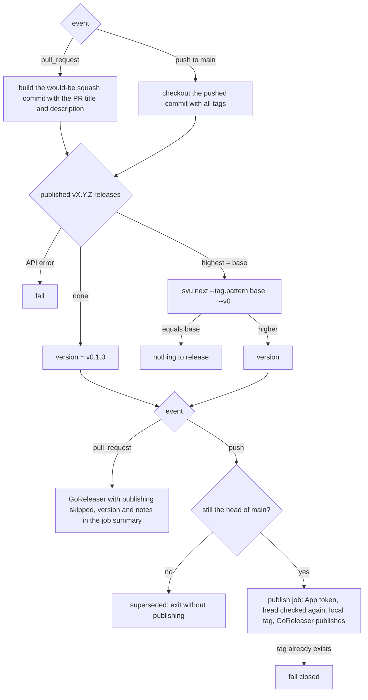
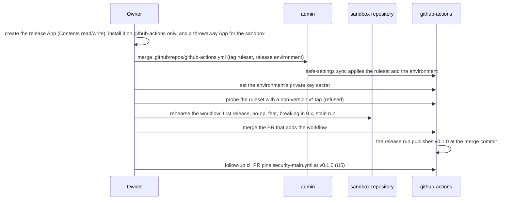

# Release Tags for the Shared Workflows - Plan

## Goal Capsule

- **Objective:** Whoever calls thatsnotmynameio/github-actions can pin a named version (`vX.Y.Z`) of the shared workflows, read what changed between two versions, and let Dependabot propose the next one.
- **Means:** this repository cuts a tagged GitHub Release whenever a merge to `main` brings a `feat`, a `fix` or a breaking change not yet released, with the version computed by svu and the release published by GoReleaser (KTD1, KTD2).
- **Product authority:** the repository's owner. Outside this repository, the work needs only a GitHub App and one settings file in thatsnotmynameio/admin (KTD4, KTD5). The consumers' pins (crew, crew-actions, corvo) and the organization's ruleset pins in admin are not active scope.
- **Stop conditions:** stop and ask the owner before merging U2 if any setup gate in the Planning Contract's Sequencing fails, if the sandbox rehearsal tags anything other than the merge commit, or if GoReleaser cannot publish with builds skipped.
- **Execution profile:** configuration and documentation in GitHub Actions YAML, a GoReleaser file and the README, plus one admin YAML file. The first release is irreversible, so the rehearsal and gates come before the merge, not after.
- **Who finishes:** an implementer writes U1–U4 as pull requests. The owner creates the GitHub App and its secrets, merges admin's change, runs the rehearsal and merges this repository's PR. U5 follows the first release.
- **Open blockers:** none.

---

## Product Contract

Product Contract preservation: changed R2, R4 — the owner chose during planning to start at `v0.1.0` and keep the series in `0.x`, with a breaking change bumping the minor there. Restructured, no scope change: R13 now says which job holds a write-capable token, R15 now says it ships after the first release. Added R16 (the go-release.yml header) at the owner's request.

### Summary

Every merge to `main` that brings an unreleased `feat`, `fix` or breaking change produces a `vX.Y.Z` tag and a GitHub Release whose notes group the changes by kind, starting at `v0.1.0`. A read-only job computes the version on every push to `main` and every pull request. A second job publishes only on `main`, with a dedicated GitHub App's token that the tag ruleset alone lets create `v*` tags. The README and the workflows' own examples switch from `@<sha> # main` to `@<sha> # vX.Y.Z`.

### Problem Frame

Every caller of these workflows pins a commit of `main` with the comment `# main`: the README's examples, the header comments of `codeql.yml` and `go-release.yml`, this repository's own `security-main.yml`, the consumers' workflows and the organization's rulesets. The repository has no tag and no release.

That costs three things at once, and the owner weighs them equally:

- **Bumping is manual.** Dependabot cannot update a pin whose comment names a branch, so each consumer's pin is moved by hand. Today they drift: crew and crew-actions pin `e72ce0d` (11 commits behind), corvo pins `4339553` and `16e57cf`, and `security-main.yml` pins `802fdb1` (13 behind).
- **Nobody can tell what changed.** Between two pinned commits there is no name, no notes, and no signal that a change requires the caller to adapt.
- **Any commit can become a pin.** Nothing marks a commit of `main` as one meant to be used.

### Key Decisions

- **A release on every merge, not batched.** Each behavior-changing merge reaches consumers on its own; the consumers' Dependabot cooldown (7 days, weekly) already batches what they see. (session-settled: user-directed — chosen over a release PR that accumulates changes and over a release started by hand: the owner wants no extra step between merge and release.) Governs R1, R5.
- **svu computes the version, GoReleaser publishes the release.** It reuses the tool and the pattern `go-release.yml` already runs in the organization, adds no third-party action with write access, and groups the notes by commit type. (session-settled: user-directed — chosen over svu with `gh release create --generate-notes`, whose notes cannot group by commit type without PR labels; over `mathieudutour/github-tag-action`, a single-maintainer Node action that would hold `contents: write` in the repository every other repository pins; and over release-please, whose release-PR model needs auto-merge and an App token to release per merge.) Governs R6, R12.
- **Major means the caller must change.** It applies once the series leaves `0.x`. (session-settled: user-approved — proposed over also counting stricter checks as major, which would make most releases majors.) Governs R3.
- **Only this repository.** (session-settled: user-directed — chosen over also migrating the consumers' workflows and the admin ruleset pins: "tamo falando só da release".) Governs R14, R15, R16.
- **The first version is `v0.1.0`, and the series stays in `0.x`.** While the major is 0, a breaking change bumps the minor; leaving `0.x` is the owner's later, deliberate call. (session-settled: user-directed — chosen over `v1.0.0` and over letting the first breaking change jump to `v1.0.0`: the owner wants to start at `v0.1.0` and decide when to reach `v1.0.0`.) Governs R2, R4.
- **Tags never move.** Immutable releases are on before the first release and there is no floating `v1` tag: SHA-pinned callers ignore a floating tag, and a moving tag would let Dependabot see one version name at two commits. (session-settled: user-approved — proposed in the scoping synthesis.) Governs R8, R9.
- **Only the release path creates `v*` tags.** A tag is what Dependabot offers every consumer and what admin's pin check accepts, so a stray tag must neither exist nor steer the version. (session-settled: user-directed — chosen over the ruleset alone, the release-only version rule alone, and accepting the risk: the ruleset closes the door, and the version rule protects the sequence until it exists or if a bypass actor errs.) Governs R10, R11.
- **`chore`, `ci`, `docs` and the other types release nothing.** svu's own table already says so, and a release that changes nothing for callers would only add Dependabot noise. (session-settled: user-approved — proposed in the scoping synthesis, with the consequence that a behavior change must be typed `fix` or `feat`.) Governs R2.

### Requirements

**Versioning**

- R1. A push to `main` releases when a `feat`, a `fix` or a breaking change has merged since the latest tag: it produces one new tag `vX.Y.Z` and one GitHub Release at the pushed commit.
- R2. The version follows svu's rule from the previous tag: a breaking change (`!` after the type, or a `BREAKING CHANGE` footer) bumps the major, `feat` the minor, `fix` the patch, except that while the major is 0 a breaking change bumps the minor; when every commit since the latest tag is of another type, no tag and no release are produced.
- R3. A change is breaking only when a caller must change something to keep working: a new required input, secret or permission; a renamed or removed workflow, job or check; or a configuration file whose format changes. A stricter check that starts failing code that used to pass is a `feat`. Authors mark a breaking change with `!` in the pull request title, which becomes the squash commit's title, and never write `BREAKING CHANGE:` in the description otherwise, since svu reads the whole commit body. The README states these rules for commit authors.
- R4. The first release is `v0.1.0`, at the commit of `main` when this ships; no older commit gets a tag.
- R5. A version is always computed from the latest release (R11), so versions are distinct and increasing. A merge whose release run failed, or was superseded by a newer run, gets no tag of its own: its change ships in the next release. A run publishes only while its commit is still the head of `main`; a run on an older commit, a re-run included, exits without publishing.

**What a release holds**

- R6. The release notes list the commits since the previous tag, grouped as breaking changes, features and fixes by their title, which is why R3 asks for `!` in the title.
- R7. A release carries no binary assets.

**Tag integrity**

- R8. The repository has immutable releases enabled before the first release, so a published `vX.Y.Z` tag cannot be moved or deleted.
- R9. Only full `vX.Y.Z` tags exist: no floating major or minor tags.
- R10. Only the release path can create, move or delete a `v*` tag: a tag ruleset on `refs/tags/v*` blocks everyone else, owners included.
- R11. The next version is computed from the latest tag that carries a published release, so a `v*` tag without a release never sets the version sequence.

**The release workflow**

- R12. The release runs svu to compute the version and GoReleaser, with builds skipped, to publish the release, in the pattern of `.github/workflows/go-release.yml`: the tag is made locally and GitHub creates it when the release is published.
- R13. The release workflow meets the bar of the repository's other workflows: it passes actionlint and zizmor, pins every action and tool by SHA or checksum, and only the job that publishes holds a write-capable token.

**What callers read**

- R14. The README's examples and the header comments of `.github/workflows/codeql.yml` and `.github/workflows/go-release.yml` show `@<sha> # vX.Y.Z`, where `<sha>` is the commit of the tag. The README explains that releases are cut on each merge, the bump rule (R2, R3), and that callers pin the tag's commit.
- R15. `.github/workflows/security-main.yml` pins this repository's `zizmor.yml` and `grype.yml` at a release's commit with the comment `# vX.Y.Z`, in a change after the first release. It stays bumped by hand, so it trails the latest release by at least one: a pull request cannot pin the tag its own merge will create.
- R16. The header of `.github/workflows/go-release.yml` says a published release is final: a run that fails after publishing leaves that version as it is, and the fix ships as the next version. It no longer tells callers to delete the release and its tag.

### Acceptance Examples

- AE1. **Covers R1, R2.** **Given** the latest tag is `v1.2.3`, **when** `feat: add the Rust checks (#30)` merges, **then** `v1.3.0` is tagged at that commit and released.
- AE2. **Covers R2, R3.** **Given** the latest tag is `v1.3.0`, **when** `fix!: rename the check to tnmn.io: golang (#31)` merges, **then** `v2.0.0` is released, and its notes list the change under breaking changes.
- AE3. **Covers R2.** **Given** nothing but `docs` and `ci` changes has merged since the latest tag, **when** `docs: explain the coverage floor (#32)` or `ci: bump the main analyses' pins (#33)` merges, **then** no tag and no release are created.
- AE4. **Covers R5.** **Given** the latest tag is `v2.0.0` and the release of `fix: … (#34)` failed, **when** `feat: … (#35)` merges and its release succeeds, **then** `v2.1.0` is released at #35's commit, #34 gets no tag of its own, and the notes list both. Had #35 been a `docs:` merge, its run would have released #34's fix as `v2.0.1`.
- AE5. **Covers R1, R5.** **When** `fix: … (#36)` and `fix: … (#37)` merge a minute apart after `v2.1.0`, **then** #36 gets `v2.1.1` and #37 gets `v2.1.2` if #36's run publishes before #37 merges; otherwise #36's run publishes nothing and #37's run releases both as `v2.1.1`. No version is ever used twice.
- AE6. **Covers R8.** **Given** `v2.1.2` is published, **when** anyone tries to delete it or point it at another commit, **then** GitHub refuses.
- AE7. **Covers R5.** **Given** #34's run failed and `v2.1.0` was released at #35, **when** someone re-runs #34's failed run, **then** it publishes nothing, because #34 is no longer the head of `main`.
- AE8. **Covers R10, R11.** **When** anyone other than the release path pushes `v9.0.0`, **then** GitHub refuses it; and a `v*` tag that exists without a release is ignored when the next version is computed.
- AE9. **Covers R4.** **Given** no release exists, **when** the pull request that adds the release workflow merges, **then** `v0.1.0` is tagged at its merge commit and released, whatever its title says.
- AE10. **Covers R2.** **Given** the latest tag is `v0.3.0`, **when** `feat!: drop the systems setting (#40)` merges, **then** `v0.4.0` is released, and its notes list the change under breaking changes.

### Success Criteria

- A consumer that pins `@<sha> # vX.Y.Z` and runs Dependabot's github-actions ecosystem receives a pull request moving it to a newer release's commit, with the release notes in its body. Proving this needs a consumer migrated, which is outside this work; it is the signal the migration will confirm.
- The admin repository's `scripts/check-pins.py` accepts a release's commit as a ruleset pin with no change, since it already accepts the commit of a tag.

### Scope Boundaries

- Migrating the consumers' pins (crew, crew-actions, corvo) from `# main` to `# vX.Y.Z`, and checking their Dependabot picks the tags up.
- Moving the organization's ruleset pins in thatsnotmynameio/admin to release commits, or bumping them automatically: Dependabot does not read admin's `.github/settings.yml`.
- A Dependabot configuration for this repository.
- A check that the pull request title follows conventional commits or marks a breaking change; until one exists, a forgotten `!` ships a breaking change as a lower bump, and the consumer's CI on the Dependabot pull request is what catches it.
- A `CHANGELOG` file in the repository: the GitHub Releases are the changelog.
- Floating major or minor tags (R9).
- Signing or attesting the release beyond the attestation immutable releases produce.
- Leaving `0.x`. Cutting `v1.0.0` is a later change the owner decides on.
- Considered and not built: a check that fails the release when the tag ruleset is missing. The setup gates come before the merge, and a misconfigured ruleset only refuses a publish, which leaves a draft and no tag; a missing ruleset would show in the gate's probe.
- Considered and not built: stepping past a version whose tag is already taken. The run fails closed and the header documents the recovery (KTD9); silently skipping a version would hide a stray tag nobody should have been able to push.
- Considered and not built: requiring a second reviewer for changes to `.github/workflows/` and `.goreleaser.yaml`, even though any workflow merged to `main` could reference the `release` environment and its key. Only the owner merges to `main`, through pull requests; a second reviewer would need a second maintainer and a change to the organization's rules.
- Considered and not built: failing a release whose notes match no group, such as a revert. Notes stay editable on an immutable release, so a thin note is fixed by hand.

### Dependencies / Assumptions

- Merges to `main` are squash merges whose title follows conventional commits, as every commit from #1 to #25 does. Branch rules allow squash only and there is no merge queue; an admin's direct push of several commits still works, because svu reads every commit since the base.
- Dependabot resolves a SHA pin whose comment names a semver tag from the repository's tags, and shows release notes in its pull request when a GitHub Release exists (dependabot-core's github_actions update checker).
- The release is published with the GitHub App's token, so the release and the tag GitHub creates do trigger workflows. Nothing in this repository listens to release or tag events today: every workflow runs on `pull_request`, `merge_group`, `workflow_call`, or `push` to `main` plus a schedule.
- Immutable releases are already enabled on this repository and enforced by the organization for every repository (`GET /repos/thatsnotmynameio/github-actions/immutable-releases` returns enabled, enforced by owner), so R8 needs no change here.

### Sources / Research

- `.github/workflows/go-release.yml`: the organization's existing GoReleaser release, which tags locally and lets GitHub create the tag on publish.
- `.github/workflows/actionlint.yml`: the pattern for installing a release binary with a pinned version and sha256 (`VERSION` and `SHA256` in `env:`, then `curl` and `sha256sum -c`).
- crew's `.goreleaser.yaml` (thatsnotmynameio/crew): the organization's changelog model (sorted ascending, no hashes, `docs|test|ci|chore` filtered out, Features and Fixes groups, `target_commitish` at the built commit).
- GoReleaser v2.18.2: with `builds: [{skip: true}]` it runs in a repository with no `go.mod` but needs `go` on the PATH; it sends no `target_commitish` unless configured; it always drafts, then publishes; changelog groups match the commit's first line only.
- svu v3.4.1 (`internal/svu/svu.go`): `next` takes the highest matching tag, prints the current version when nothing releasable is pending, matches titles with unanchored, case-insensitive patterns and `BREAKING CHANGE:` anywhere in the body, and with `--v0` turns a breaking change into a minor bump while the major is 0. Its v3.4.1 release is itself immutable.
- GitHub rulesets: the GitHub Actions integration cannot be a ruleset bypass actor (HTTP 422, "must be part of the ruleset source or owner organization"); a GitHub App can. GitHub immutable releases: https://docs.github.com/en/code-security/concepts/supply-chain-security/immutable-releases
- zizmor audits `secrets-outside-env` (secrets only from an environment) and `github-app` (App tokens scoped to repositories and permissions, revocation kept).
- thatsnotmynameio/admin: safe-settings deletes organization rulesets missing from `.github/settings.yml` at each sync, and repository rulesets missing from a repository's file once that file has a `rulesets:` key. `scripts/check-pins.py` accepts the commit of a tag as a pin.
- How large action repositories release: actions/checkout, docker/build-push-action and step-security/harden-runner release by hand; github/codeql-action prepares releases through its own PR workflows; googleapis/release-please-action uses a release PR. None releases per merge, so this plan uses a tool for the per-merge part rather than copying one of them.

---

## Planning Contract

### Key Technical Decisions

- KTD1. **The version step reads the published releases, then asks svu.** The base is the highest `vX.Y.Z` among the repository's published, non-draft releases, listed through the API, filtered on `^v[0-9]+\.[0-9]+\.[0-9]+$` and sorted by version. An empty list means no release yet, and the version is `v0.1.0` without consulting svu. Otherwise the version is `svu next --tag.pattern <base> --v0`, where the exact pattern makes svu ignore every other tag. When the result equals the base, nothing is released. Any API error fails the run, so a failed lookup is never read as "no release yet". `releases/latest` is not used, because it follows an editable flag and accepts tags that are not versions. (session-settled: user-directed — chosen over starting at `v1.0.0` and over leaving `0.x` on the first breaking change: it carries out the owner's first-version decision.) Governs R2, R4, R11.
- KTD2. **GoReleaser publishes at the built commit.** `.goreleaser.yaml` skips builds, archives, checksums and the source archive (R7), and sets `release.target_commitish` to the full commit, the one setting whose error would be irreversible, since without it GitHub tags whatever `main`'s head is at publish. The publishing job tags the version locally and passes the base as GoReleaser's previous tag, so the notes cover exactly the commits since the last release. GoReleaser reuses a leftover draft of the same name instead of creating a second one. Changelog groups follow crew's model plus a breaking group first, with `!` titles kept out of the features and fixes groups, and an "Other changes" group so a revert or an unusual title still shows. Governs R6, R7, R12.
- KTD3. **Two jobs: a read-only version job and a publishing job.** The `version` job runs with `contents: read` on every push to `main` and every pull request, and decides whether to release. The `publish` job runs only on a push to `main` when the version job says so, in the `release` environment, with the GitHub App's token; `GITHUB_TOKEN` never writes. Pushes to `main` run one at a time in the concurrency group `release`, never cancelling a running one; pull requests run in a group of their own per pull request, cancelling their own older runs as `codeql.yml` does, so a preview can never replace a pending release run. The publishing job checks again, right before GoReleaser, that its commit is still the head of `main`. A merge that releases nothing creates no deployment and mints no token. Governs R5, R13.
- KTD4. **A dedicated GitHub App is the only actor that creates `v*` tags.** The GitHub Actions integration cannot be a ruleset bypass actor, so an organization-owned App with Contents read and write only, installed on this repository only, is the ruleset's single bypass. Its client ID is a variable of the `release` environment, declared in admin (KTD5), and its private key a secret of that environment, set by the owner; the environment deploys only from `main`. The token is minted per run for this repository with contents write only, and revoked at the end. (session-settled: user-approved — proposed in the plan's scoping synthesis as the only way the ruleset can let the release through.) Governs R10, R13.
- KTD5. **The tag ruleset and the `release` environment live in admin.** A new `.github/repos/github-actions.yml` in thatsnotmynameio/admin holds a repository ruleset (`target: tag`, `refs/tags/v*`, creation, update and deletion, the App as the only bypass), the environment with its client ID variable, and the squash-commit settings U4 lists. safe-settings would delete a ruleset made by hand at its next sync. (session-settled: user-approved — proposed in the plan's scoping synthesis as the one change outside this repository.) Governs R10.
- KTD6. **svu is installed like actionlint is.** The `linux_amd64` tarball of v3.4.1, with its version and sha256 (`7ee8c91998c15109130638dc661a912d5f426e2f8642f6f6c04e6502be920770`) in `env:`, is downloaded and checked with `sha256sum -c` before use, as `.github/workflows/actionlint.yml` installs actionlint. Governs R13.
- KTD7. **Every pull request previews its release.** On a pull request, the version job builds the squash commit the merge would create (the base branch plus the PR's changes, with the PR's title and description as the commit's title and body, as admin's settings for this repository make GitHub do, per U4), runs the same version step on it, tags that commit locally, and renders the notes with GoReleaser's release pipeline with publishing skipped, writing both to the job summary. A snapshot would not do: GoReleaser v2.18.2 skips the changelog in snapshot mode. No token beyond `GITHUB_TOKEN` read is used. The PR title and description reach the shell only through environment variables. (session-settled: user-approved — proposed in the plan's scoping synthesis because the first release cannot be undone.) Governs R1, R2, R4, R6.
- KTD8. **Setup gates come before the merge.** The App, the environment and its secrets, admin's ruleset and a sandbox rehearsal must all be in place before the pull request that adds the workflow merges, because that merge publishes `v0.1.0`. A missed step fails the publishing job at the token step, before anything is published, so it leaves no tag and the next push retries. Governs R4, R10.
- KTD9. **A taken version name fails closed.** When the computed version's tag already exists, the local tag step fails and nothing is published. The workflow's header says how to recover: a stray tag is removed by an owner after a pull request to admin's file temporarily lifts the deletion rule (a change made by hand would be undone at the next sync), and a published release is never deleted, since its name is burned for good. Governs R5, R10.

### High-Level Technical Design

The version decision, for one run of the workflow:

The one-time setup and the first release, across three places:

### System-Wide Impact

- Callers see nothing until they move their pins: every existing `@<sha> # main` pin keeps working, and check-pins accepts release commits as they are.
- Creating admin's `.github/repos/github-actions.yml` with a `rulesets:` key makes safe-settings delete any repository ruleset on github-actions that the file does not list. None exists today; from then on, rulesets for this repository live in that file.
- The App's token triggers workflows on release and tag events. No workflow here listens to them; one added later would run on every release.

### Risks

- **Title false positives.** svu matches titles loosely, so `chore: … prefix: …` or `hotfix: …` bumps the patch, and a `BREAKING CHANGE:` line left in a squash body bumps beyond what the title says. Accepted: R3's author rules and the PR preview, which shows the computed version before the merge, are the defense.
- **The preview's notes path.** GoReleaser's release pipeline with publishing skipped is expected to render the changelog without a write token; if it insists on one, the preview shows the version alone and the notes are checked in the sandbox rehearsal instead.

### Sequencing

1. U1 to U3 are written in one pull request in this repository, and U4 in one pull request in admin. Both can be reviewed in parallel.
2. Before this repository's pull request merges, every gate below holds, in order:
   1. The release App exists, has Contents read and write only, and is installed on github-actions only; its private key is stored only in github-actions' `release` environment. The sandbox rehearsal uses a separate throwaway App installed only on the sandbox, as the sandbox ruleset's bypass.
   2. Admin's U4 is merged and safe-settings has applied it: the repository shows a `target: tag` ruleset with only the App as bypass, and the `release` environment deploys from `main` only.
   3. The environment holds the App's private key (secret); its client ID comes from admin's file. The repository reports `PR_TITLE` and `PR_BODY` as its squash commit title and message.
   4. A probe push of a non-version tag such as `v-ruleset-probe` is refused. If it is not, delete the probe tag, which has no release, and fix the ruleset.
   5. The sandbox rehearsal passes (Verification Contract).
   6. This repository's pull request shows the preview `v0.1.0` in its job summary.
3. The merge publishes `v0.1.0`. U5 follows as a `ci:` pull request.

---

## Implementation Units

**Target repositories:** thatsnotmynameio/github-actions (this repository) for U1, U2, U3 and U5; thatsnotmynameio/admin for U4. Paths are relative to each unit's repository.

### U1. GoReleaser configuration for a release with no builds

**Goal:** A `.goreleaser.yaml` that publishes a GitHub Release with grouped notes and no assets, at the built commit.

**Requirements:** R6, R7, R12; KTD2.

**Dependencies:** none.

**Files:**
- Create `.goreleaser.yaml`

**Approach:**
1. Header comment in crew's style: what a release publishes, which workflow decides when, and that the tag is only local until GitHub creates it at the built commit on publish.
2. `version: 2`, `project_name: github-actions`, builds skipped, and no archives, checksums or source archive.
3. Changelog per KTD2: `use: git`, sorted ascending, no hashes, `docs`, `test`, `ci` and `chore` filtered out, groups in the order breaking changes, features, fixes, other changes.
4. Release per KTD2: name is the tag, `target_commitish` the full commit, reuse an existing draft, marked latest.

**Patterns to follow:** crew's `.goreleaser.yaml`; `.github/workflows/go-release.yml`'s comments on the local tag.

**Test scenarios:**
- Covers AE2. A history with `fix!: rename the check (#31)` after the base renders it under breaking changes only, not also under fixes.
- Covers AE10. A history with `feat!: drop the systems setting (#40)` renders it under breaking changes only, not also under features.
- A history with `feat: …`, `fix: …` and `docs: …` renders the feature and the fix in their groups and leaves the docs commit out.
- A `fix: revert add the Rust checks (#30)` title renders under fixes, and a title outside every group, such as GitHub's default `Revert "…"`, renders under other changes.
- A run with publishing skipped produces no archive, binary or checksum artifacts.

**Verification:** `goreleaser check` passes, and the PR preview of U2 shows the grouped notes for this pull request's history.

### U2. The release workflow

**Goal:** `.github/workflows/release.yml` computes the version on every push to `main` and every pull request, previews it on pull requests, and publishes on `main`.

**Requirements:** R1, R2, R4, R5, R11, R12, R13; KTD1, KTD3, KTD4, KTD6, KTD7, KTD8, KTD9.

**Dependencies:** U1. Its merge is gated by the Sequencing gates, which need U4.

**Files:**
- Create `.github/workflows/release.yml`

**Approach:**
1. Header comment: what the workflow does, when a merge releases (R1, R2), that a published version is final and the next release carries a fix (R16's wording), that a superseded run shows as cancelled or exits early, and the recovery for a taken name (KTD9).
2. Triggers: `push` to `main`, and `pull_request` with the types opened, synchronize, reopened and edited, so a title change recomputes the preview. Top-level `permissions: {}` and a concurrency group keyed on the event per KTD3.
3. `version` job, `contents: read`: check out with full history and tags, without persisted credentials. On a pull request, build the would-be squash commit locally per KTD7. Install svu per KTD6. Compute the base and the version per KTD1. On a push, compare the commit with `main`'s current head. Outputs: whether to release, the version, the base. On a pull request, tag the would-be squash commit locally, run GoReleaser through the pinned action and version that `go-release.yml` uses with publishing skipped (KTD7), and write the version and the notes to the job summary.
4. `publish` job, only on a push and when the version job says to release: environment `release`, `contents: read` for `GITHUB_TOKEN`. Mint the App token per KTD4; it fails on a missing client ID or key before anything is published (KTD8). Check out without persisted credentials, set up Go without a cache (GoReleaser needs `go` on the PATH), check the head again, tag the version locally, and run GoReleaser with the App token and the base as previous tag.

**Execution note:** most of this is configuration; prove it with the PR preview and the sandbox rehearsal rather than unit tests, and rehearse before the irreversible first run.

**Technical design:** the flowchart in High-Level Technical Design is the decision this unit implements.

**Patterns to follow:** `.github/workflows/go-release.yml` (checkout, setup-go without a cache, goreleaser-action and its pinned version, the local tag); `.github/workflows/actionlint.yml` (installing a binary with a pinned sha256); the README's release caller snippet (`concurrency` group `release`).

**Test scenarios:**
- Covers AE9. With no published release, the version job outputs `v0.1.0` and release true, whatever the title.
- Covers AE1. With `v1.2.3` released and a `feat:` commit after it, the version is `v1.3.0`.
- Covers AE10. With `v0.3.0` released and a `feat!:` commit after it, the version is `v0.4.0`.
- Covers AE3. With only `docs:` and `ci:` commits since the base, release is false, and the publish job is skipped.
- Covers AE4. With a `fix:` after the base and then a `docs:` merge, the `docs:` run releases the fix as a patch.
- Covers AE8. A tag `v9.0.0` with no release does not change the base.
- An older release that someone marks as latest does not change the base.
- A release on a non-version tag such as `nightly` does not change the base.
- An API error while listing releases fails the version job instead of yielding `v0.1.0`.
- Covers AE5, AE7. A run whose commit is no longer the head of `main` exits without publishing, both in the version job and at the publishing job's second check.
- With the environment's private key missing, the publish job fails at the token step and nothing is published.
- When the computed version's tag already exists, the publish job fails and publishes nothing.
- On a pull request titled `feat: …`, the job summary shows the next minor version and the notes.

**Verification:** the org's required actionlint and zizmor checks pass on the pull request, and the preview shows `v0.1.0`. The sandbox rehearsal stages the first release, the `docs:`, `feat:` and `feat!:` merges, a stray release-less tag, an older release marked latest, a release on a `nightly` tag, a stale run and a missing private key. The API-error and taken-name scenarios are checked by review of the version and tag steps, since they cannot be staged safely.

### U3. What callers read

**Goal:** The README and the workflows' header comments tell callers to pin a release's commit and how versions are cut, and go-release.yml's header stops recommending what immutable releases forbid.

**Requirements:** R3, R14, R16.

**Dependencies:** none.

**Files:**
- Modify `README.md`
- Modify `.github/workflows/codeql.yml`
- Modify `.github/workflows/go-release.yml`
- Modify `.github/workflows/security-main.yml`

**Approach:**
1. README: every caller example (the zizmor, CodeQL, Go, go-release and Python snippets) pins `@<sha> # vX.Y.Z`.
2. README: a new section, placed before "Checks required by the organization" and not under go-release's "Releases", on versions: a release on each merge that brings a `feat`, `fix` or breaking change; the bump rule including `0.x` (R2); what counts as breaking and how authors mark it (R3); that a revert of a change that released is titled `fix: revert <the reverted subject, without its type>` so it ships as a release, and `revert: …` is only for reverting a change that released nothing; that callers pin the tag's commit, which Dependabot then keeps current.
3. `codeql.yml` and `go-release.yml` header comments: the caller example pins `@<sha> # vX.Y.Z`.
4. `go-release.yml` header: replace "delete both, then start again" with R16's wording, a published release is final and the fix ships as the next version.
5. `security-main.yml`: the comment says its pins are bumped by hand to a release's commit. The pins themselves wait for U5.

**Patterns to follow:** the README's existing voice (short declarative sentences, the `tnmn.io:` naming), the header comments' existing structure.

**Test expectation:** none -- documentation only; checked by review against R14 and R16.

**Verification:** no caller example in the README or the two header comments carries `# main`; the go-release header no longer mentions deleting a release or tag.

### U4. The tag ruleset and the release environment in admin

**Goal:** thatsnotmynameio/admin declares github-actions' tag ruleset, its `release` environment and its squash-commit settings, so safe-settings keeps them.

**Requirements:** R3, R10; KTD4, KTD5, KTD7.

**Dependencies:** the GitHub App exists (Sequencing gate 1).

**Files (in thatsnotmynameio/admin):**
- Create `.github/repos/github-actions.yml`

**Approach:**
1. Header comment in the style of `.github/repos/crew.yml` ("github-actions's own settings, over .github/settings.yml"), saying why only the App may create, move or delete `v*` tags.
2. A ruleset `release tags`: `target: tag`, `enforcement: active`, `refs/tags/v*`, creation, update and deletion, the App as the only bypass actor (`actor_type: Integration`, by slug or id, `bypass_mode: always`).
3. An environment `release` deploying from `main` only (a custom branch policy), with no required reviewers, and the App's client ID under its `variables:`. safe-settings 3.0.0 treats an environment's variables as fully managed and deletes any it does not declare, so the client ID must live here, not be set by hand.
4. Repository settings for github-actions: `squash_merge_commit_title: PR_TITLE` and `squash_merge_commit_message: PR_BODY`, so the squash commit carries the pull request's title and description, which R3's author rule and KTD7's preview rely on. The organization's default, `COMMIT_OR_PR_TITLE` with `COMMIT_MESSAGES`, titles a single-commit pull request with its commit's headline instead.

**Patterns to follow:** `.github/repos/crew.yml` and the rulesets in `.github/settings.yml` in admin.

**Test expectation:** none -- settings only; proved by the Sequencing probe and the first publish.

**Verification:** after safe-settings syncs, `gh api repos/thatsnotmynameio/github-actions/rulesets` lists the tag ruleset with only the App as bypass; the probe tag is refused; the environment exists with its branch policy and the client ID variable; the repository reports `PR_TITLE` and `PR_BODY`.

### U5. security-main.yml pins the first release

**Goal:** This repository's own analyses of `main` run the released workflows.

**Requirements:** R15.

**Dependencies:** `v0.1.0` exists.

**Files:**
- Modify `.github/workflows/security-main.yml`

**Approach:** pin `zizmor.yml` and `grype.yml` at `v0.1.0`'s commit with `# v0.1.0`, in a pull request titled `ci: …`, which releases nothing.

**Test expectation:** none -- a pin bump; its merge run proves it.

**Verification:** the merge's `security (main)` run uses the release commit and the release workflow reports nothing to release.

---

## Verification Contract

| Gate | Applies to | Done signal |
|---|---|---|
| Org-required checks on the pull request: `tnmn.io: actionlint` (with shellcheck), `tnmn.io: zizmor` (`--no-ignores`), `tnmn.io: grype`, `tnmn.io: dependency-review`, plus CodeQL | U1, U2, U3, U5 | all green, no new zizmor alert |
| `goreleaser check` on `.goreleaser.yaml` | U1 | passes |
| The PR preview | U1, U2 | the job summary shows `v0.1.0` and grouped notes |
| Sandbox rehearsal: a throwaway org repository with the same workflow and `.goreleaser.yaml`, its own throwaway App, environment and a tag ruleset made by hand | U1, U2, U4 | the first merge publishes `v0.1.0` at the merge commit; a `docs:` merge publishes nothing; a `feat:` merge bumps the minor; a `feat!:` merge bumps the minor in `0.x`; a run made stale by a second merge publishes nothing; an owner's tag push is refused; deleting a release's tag is refused (AE6, sandbox only) |
| Ruleset probe on github-actions with `v-ruleset-probe` | U4 | refused |
| After the first release: `gh release view v0.1.0` and the tag's commit | U2 | the tag points at the merge commit, the release is immutable, has no assets, and is the only `v*` tag |

AE6 is never attempted on github-actions' real tags.

---

## Definition of Done

- U1, U2 and U3 are merged in one pull request after every Sequencing gate held, and `v0.1.0` exists at its merge commit with grouped notes and no assets.
- U4 is merged in admin and applied by safe-settings.
- U5 is merged after `v0.1.0`, and its run released nothing.
- No caller example in this repository says `# main`.
- The sandbox repository, its throwaway App and any probe tag are deleted.
- No leftover experimental workflow, script or tag from the rehearsal remains in github-actions.
