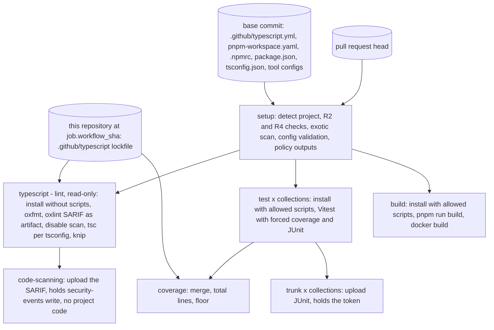

# TypeScript checks (tnmn.io typescript) - Plan

## Goal Capsule

- **Objective:** every pull request to one of the organization's TypeScript repositories is checked before merge for broken code, too-fresh or untrusted dependencies, and weakened checks, and the pull request itself cannot loosen any of those checks.
- **Means:** a new required workflow, `tnmn.io: typescript` (`.github/workflows/typescript.yml`), built on `python.yml`'s job layout (KTD1), with pnpm's supply-chain policy forced from the environment (KTD3) and every tool configuration taken from the base commit (KTD8). Issue #29.
- **Product authority:** this plan covers the base TypeScript check only. The checks of a JavaScript action (#30), of a Cloudflare Worker (#31), the npm licenses in dependency review (#32, done in #38), the release (#33) and the ecosystem audit tools (#27) are separate work. The Product Contract wins on behavior; the KTDs win on mechanism.
- **Execution profile:** workflow YAML and shell, in this repository. No test harness exists here; each unit is proven on a scratch TypeScript repository (Verification Contract).
- **Stop conditions:** stop and report if `job.workflow_sha` is unavailable to a ruleset-required workflow (KTD2), or if pnpm ignores an environment override that KTD3 relies on and no other route forces it.
- **Who finishes:** the implementer opens one pull request in this repository, titled `feat: …`. Moving the organization ruleset's pin in thatsnotmynameio/admin is follow-up work.
- **Open blockers:** none.

---

## Product Contract

Product Contract preservation: changed R6, R10, R11, R12, R14 and R15, and the coverage Key Decision. These changes were confirmed in the plan's scoping synthesis. The plan review then changed R5 (local tarballs), R10 (reference to R12) and R13 (projects without tests under a floor), with the user's approval. The Outstanding Questions were resolved into KTD2-KTD11.

### Summary

A required check, `tnmn.io: typescript`, for a single TypeScript package at the repository root. It installs with pnpm under the organization's release-age and trust rules, then runs format, lint and type checks, Vitest with coverage, and the project's build. A rule that could turn a check off comes from the base commit, never from the pull request.

### Problem Frame

The organization will build GitHub Apps on Octokit and JavaScript actions, both in TypeScript. Its only TypeScript repository today, `repository-dispatch`, is a fork that nothing checks. Go and Python repositories already have required checks (`go.yml`, `python.yml`), but a TypeScript pull request merges with no lint, no type check, no tests and no dependency gate.

The risk is concrete. An App runs next to its private key and, on Workers, a Cloudflare token. A malicious npm version can harm in two ways: through an install script, or through code that ships inside the App's bundle. A freshly published version is the usual carrier, and nothing today stops one from landing in a lockfile.

The existing stacks set a rule this one must keep. The settings that could turn a check off come from the base commit, so a pull request cannot exempt itself (`python.yml:12-16`).

### Key Decisions

- **pnpm, not npm.** (session-settled: user-directed — chosen over npm: it blocks dependency scripts by default and has release-age and trust-policy gates.) Governs R4-R8.
- **oxlint and oxfmt, not ESLint and Prettier.** (session-settled: user-approved — chosen over ESLint: its config imports plugins from the pull request's `node_modules`, so it cannot be pinned from outside.) Governs R9, R10.
- **TypeScript 7, and a warning, not a failure, below it.** (session-settled: user-directed — chosen over staying on TypeScript 5/6, since nothing needs the old JavaScript API without ESLint.) Governs R10, R12.
- **Separate workflows composed by rulesets, not nested ones.** (session-settled: user-directed — chosen over a `github-actions` workflow that calls this one: an app that is both a Worker and an image would run these checks twice.) Governs R1.
- **One package at the repository root.** (session-settled: user-approved — chosen over supporting pnpm workspaces now: Go and Python also assume one project at the root, and no workspace exists yet.) Governs R2.
- **The pull request's `tsconfig.json`, with rigor and file selection imposed from the base.** (session-settled: user-approved — chosen over the base's whole `tsconfig.json`, which would fail any pull request that changes `paths` or module resolution, and over the pull request's whole file, which can set `strict: false` or an empty `include`.) Governs R11.
- **Install scripts run only for the packages the base allows.** (session-settled: user-approved — chosen over never running them, which leaves no exception for native binaries. The test jobs already run dependency code with no secrets, so the added risk is small.) Governs R6.
- **Git and tarball dependencies only when the base lists them.** (session-settled: user-approved — chosen over forbidding them always, which blocks a legitimate fork, and over pnpm's default of allowing direct ones, which leaves review as the only barrier.) Governs R5.
- **No bypass of the release age, not even for Dependabot security updates.** (session-settled: user-approved — chosen over relaxing it for Dependabot security PRs: a compromised "fix" version is itself an attack vector, and an advisory can be forged.) Governs R5, R7.
- **The workflow decides pnpm's version, and the project's pin is ignored.** Failing on a mismatch would force every repository to track the workflow's exact pnpm, and break them at each workflow bump. Governs R8.
- **The base decides what coverage measures and which provider measures it.** (session-settled: user-approved — chosen over the pull request's Vitest configuration choosing the provider: a `custom` provider can report any number.) A Worker sets Istanbul in its base configuration (#31). Governs R14, R15.

### Requirements

**Scope and trust**

- R1. The check is named `tnmn.io: typescript`, required by an organization ruleset on the TypeScript repositories. The checks of what a project ships are other workflows that rulesets require alongside it.
- R2. A project is a commit with `package.json` at the root. Without one, the check passes with a notice that there is nothing to check. With one, it fails when `pnpm-lock.yaml` or `tsconfig.json` is missing, and when the base has `package.json` and the pull request removes it.
- R3. The settings that could turn a check off are read from the pull request's base commit: `.github/typescript.yml`, the formatter's and linter's configuration and ignore files, the type check's strictness options and file selection (R11), knip's configuration (R17), and the exception lists of R5 and R6. A change to them applies once it merges.

**Install**

- R4. The install uses the committed lockfile unchanged and runs no pnpmfile. It fails when the pull request's `pnpm-workspace.yaml` declares `configDependencies`, a `pnpmfile` or `dangerouslyAllowAllBuilds`, or when its `pnpm-workspace.yaml` or `.npmrc` sets a registry the base does not.
- R5. Every package version in the lockfile must be at least 24 hours old and must not downgrade its publisher's trust evidence, which pnpm checks again on install. The workflow sets the age and the trust policy itself, so the pull request's settings cannot lower them, and the only exceptions are those the base's `pnpm-workspace.yaml` lists. A dependency resolved from a git repository, a tarball URL or a local tarball (`file:`), direct or transitive, has no publish time or provenance to check, so it fails unless the base's configuration lists it.
- R6. Dependency install scripts run only for the packages the base's `allowBuilds` lists. A package whose scripts the base has not allowed installs without running them, with a warning, and a pull request that adds a package to `allowBuilds` does not get its scripts run until that change merges.
- R7. Dependabot pull requests, security updates included, follow R5 with no exception. A version younger than 24 hours fails, and passes on a re-run once it is old enough, or once the base exempts it.
- R8. The pnpm version is the workflow's. A `packageManager` or `devEngines.packageManager` in the pull request neither switches pnpm's version nor fails the check.

**Format, lint and types**

- R9. Formatting is checked with oxfmt, at the workflow's version, with the base's configuration and ignore file.
- R10. Lint runs oxlint, type-aware except below TypeScript 7 (R12), at the workflow's version, with the base's configuration. Its findings go to code scanning. The base's rules forbid `@ts-ignore`, `@ts-nocheck` and `any`, and a comment that disables those rules fails the check; other disable comments are allowed, as `# noqa` is in Python. The base's configuration uses only oxlint's built-in rules, and the check fails when it declares `jsPlugins`, whose code would come from the pull request's lockfile.
- R11. The type check runs on the pull request's `tsconfig.json`, with the base's strictness options imposed over it and the files it checks being the union of the base's and the pull request's selection. A pull request cannot turn strictness off or drop files the base checks.
- R12. The type check uses the project's own TypeScript, from its lockfile, and its type errors fail the check at any version. Below version 7 the check warns and lint (R10) runs without its type-aware rules, which need a configuration TypeScript 7 accepts. A pull request that lowers TypeScript below 7 on a base already at 7 fails.

**Tests and coverage**

- R13. The tests run with the project's own Vitest, from its lockfile. A project without test files passes, unless a floor is set (R15). With Trunk collections named in `.github/typescript.yml`, there is one test job per collection, and its results go to Trunk, as in `python.yml`.
- R14. Coverage is collected whenever the project has the provider `.github/typescript.yml` names (V8 by default) installed, and always when a floor is set. It measures `src/` when that directory exists and the whole project otherwise, whatever the project's Vitest configuration includes or excludes.
- R15. When `.github/typescript.yml` sets a floor, the workflow computes total coverage over every test job's data and fails below the floor, and fails when there is no coverage data at all. A threshold in the project's own configuration plays no part.

**Build and shipped dependencies**

- R16. The project's `build` script runs when `package.json` has one, and `docker build` runs when the repository has a `Dockerfile`.
- R17. The check fails when production code imports a package declared only in `devDependencies`. A bundle ships such a package all the same.

**Around the check**

- R18. Code scanning analyzes `javascript-typescript` when the commit has `package.json`.
- R19. Only the job that uploads to Trunk holds a secret, and it runs none of the project's code.
- R20. The README documents the TypeScript check, as it does Go's and Python's.
- R21. Known vulnerabilities stay with `tnmn.io: grype`, which reads `pnpm-lock.yaml`. This workflow runs no `npm audit` or `pnpm audit`.

### Acceptance Examples

- AE1. **Covers R2.** **Given** a repository with no `package.json`, **when** a pull request runs the check, **then** it passes with a notice. **Given** `package.json` and no `pnpm-lock.yaml`, **then** it fails and says how to fix it. **Given** a base with `package.json` and a pull request that deletes it, **then** it fails.
- AE2. **Covers R5, R7.** **Given** a pull request whose lockfile brings a version published 3 hours ago, **when** the check runs, **then** the install fails, even when Dependabot opened it as a security update. **Given** that the base's `minimumReleaseAgeExclude` names the package, **then** it passes.
- AE3. **Covers R5, R3.** **Given** a pull request that adds its own package to `minimumReleaseAgeExclude`, **when** the check runs, **then** the exception does not apply, because it is not in the base yet.
- AE4. **Covers R6.** **Given** a pull request that adds `sharp` to `allowBuilds`, **when** the check runs, **then** `sharp`'s install script does not run and the install warns. After that change merges, it runs on the next pull request.
- AE5. **Covers R8.** **Given** a pull request that sets `packageManager: pnpm@10.0.0`, **when** the check runs, **then** the workflow's pnpm runs, and the field neither changes the version nor fails the check.
- AE6. **Covers R11.** **Given** a pull request that sets `"strict": false` or `"include": []` in `tsconfig.json`, **when** the check runs, **then** the base's strictness and file selection still apply. **Given** a pull request that changes `paths`, or moves `src/` to `lib/` and includes `lib`, **then** the type check uses the new `paths` and checks `lib/`.
- AE7. **Covers R12.** **Given** a lockfile with TypeScript 6 on a base without TypeScript 7, **when** the check runs, **then** the type check warns, passes when the types are correct and fails on a type error, and lint passes without its type-aware rules even when `tsconfig.json` uses options TypeScript 7 removed. **Given** a base at TypeScript 7 and a pull request that lowers it to 6, **then** it fails.
- AE8. **Covers R14, R15.** **Given** a floor of 90 and a pull request whose Vitest configuration excludes most of `src/` from coverage, **when** the check runs, **then** coverage is still measured over all of `src/` and the floor fails when the total is below 90. **Given** a floor and a pull request that deletes every test, **then** it fails.
- AE9. **Covers R17.** **Given** `src/index.ts` importing a package listed only in `devDependencies`, **when** the check runs, **then** it fails and names the package.
- AE10. **Covers R4, R5.** **Given** a pull request whose `pnpm-workspace.yaml` sets `minimumReleaseAge: 0`, `trustPolicy: off` or `trustLockfile: true`, **when** the check runs, **then** the workflow's age and trust policy still apply. **Given** one that declares `configDependencies` or `dangerouslyAllowAllBuilds`, or whose `.npmrc` sets a registry the base does not, **then** it fails.
- AE11. **Covers R5.** **Given** a pull request that adds `"foo": "github:someone/foo#<sha>"`, **when** the check runs, **then** it fails until the base's configuration lists that dependency.
- AE12. **Covers R10.** **Given** a pull request with `// oxlint-disable-next-line typescript/no-explicit-any`, or with its own `oxlint-suppressions.json`, **when** the check runs, **then** the first fails the check and the second is ignored. **Given** `// oxlint-disable-next-line no-console`, **then** it passes.

### Scope Boundaries

- **Deferred for later**
  - pnpm workspaces and multiple packages in one repository, until a real repository needs them.
  - Turning the warning below TypeScript 7 into a failure.
  - A smoke test of the built artifact, which no stack runs today.
  - A guard in `grype.yml` against an empty SBOM (anchore/syft#5241), recorded on #27.
- **Outside this check**
  - Private registries that need a token: no job that installs holds a secret (R19).
  - Inline disable comments for rules other than those R10 names, which review sees in the diff, as with Python's `# noqa`.
- **Separate work**
  - The checks of a JavaScript action (#30) and of a Cloudflare Worker (#31).
  - The npm licenses in dependency review (#32, done in #38).
  - The release workflow (#33).
  - The evaluation of actions/reusable-workflows (#26) and of each ecosystem's audit tools (#27).
  - Migrating `repository-dispatch`.

#### Deferred to Follow-Up Work

- A pull request in thatsnotmynameio/admin adds the ruleset for `tnmn.io: typescript`, pinned to the commit of the release this change's merge publishes. Titled `feat: …`, it bumps the minor (README `## Versions`).

### Dependencies / Assumptions

- pnpm 11.1.3 or later checks the lockfile's entries against the release age and the trust policy on install (`ERR_PNPM_MINIMUM_RELEASE_AGE_VIOLATION`, `ERR_PNPM_TRUST_DOWNGRADE`). R5 relies on it, and on the workflow's pnpm being at least that version.
- pnpm 11 and 12 switch to the version a project pins by default (`pmOnFail: download`), and an environment setting overrides both the workspace file and the manifest. R8 relies on that setting.
- Dependabot honors pnpm's release age for transitive dependencies since dependabot-core v0.392.0 (PR #15485, 2026-08-17), so most Dependabot pull requests should not hit R7. That github.com runs that version is unconfirmed.
- grype (syft v1.54.1) catalogs `pnpm-lock.yaml` v9+, development dependencies included. A `devEngines.runtime` entry can empty the SBOM (anchore/syft#5241), so projects take Node's version from `.node-version`.
- The tools' lockfile needs no license exemption: a sample install of oxlint, oxlint-tsgolint, oxfmt, knip and typescript holds only MIT, Apache-2.0, ISC and BSD-3-Clause. Consumers' trees need `lightningcss` (Vitest 5, through vite 8) and `caniuse-lite` (Istanbul coverage, through babel), exempted by #38. GitHub reports every package of `pnpm-lock.yaml` as runtime, so development dependencies are checked against the same list.

### Outstanding Questions

**Deferred to Implementation**

- Vitest #11144 is still open: under TypeScript 7, `expect(x).not` fails the type check, so a project's tests fail R11 and R12. U4 verifies the module-augmentation workaround the issue suggests on the scratch repository and documents it in the README. If the workaround fails, stop and bring the choice back, since dropping tests from the imposed selection would narrow R11.

### Sources / Research

- `.github/workflows/python.yml`: base-commit configuration (lines 111-158 and 177-218), forced coverage source and floor (lines 329-389), and Trunk's secret confined to its job (lines 391-447).
- `.github/workflows/go.yml:263-268`: a floor computed by the workflow; `go.yml:269-278`: the project's own tool when it declares one.
- `.github/workflows/codeql.yml:48-66`: the language detection that R18 extends.
- `.github/workflows/grype.yml:81`: scans `.`, so it reads `pnpm-lock.yaml`.
- pnpm 12 configuration precedence: `docs/configuring.md` line 46 and `crates/config/src/loading.rs` lines 19-227 (env and CLI replace the workspace file's values; `registries`, `configDependencies` and `catalogs` are workspace-file only).
- pnpm `pmOnFail`: `docs/settings/cli.md` lines 92-131.
- oxlint 1.88.0 loads `oxlint-suppressions.json` from the working directory with no flag to turn it off (`apps/oxlint/src/lint.rs` line 405); tsgolint picks the nearest `tsconfig.json` per file and ignores `--tsconfig`.
- Vitest 5.0.5: command-line options override the config and replace arrays (`testConfig.ts` lines 69-81); `coverage.include` counts untested files.
- knip 6.41.0 `--strict` reports a production import of a dev-only package as `unlisted` (`packages/knip/src/DependencyDeputy.ts` lines 289-294).
- create-cloudflare 2.74.0 hello-world TS: root `tsconfig.json` excludes `test`, and `test/tsconfig.json` extends it.
- [vitest-dev/vitest#11144](https://github.com/vitest-dev/vitest/issues/11144), [anchore/syft#5241](https://github.com/anchore/syft/issues/5241), [dependabot-core#15485](https://github.com/dependabot/dependabot-core/pull/15485).
- Issues #29 to #33, and #27's grype addendum.

---

## Planning Contract

### Key Technical Decisions

- KTD1. **`python.yml`'s shape, one file, seven jobs.** `setup`, `typescript` (named `(lint)`), `code-scanning`, `test`, `coverage`, `trunk` and `build`, with the same triggers (`pull_request`, `merge_group`, `workflow_call` with an optional `TRUNK_API_TOKEN`), no `push:` trigger and no concurrency block, and `contents: read` at the top. Unlike `python.yml`, the lint job holds no write permission: it runs the project's `tsc` and knip loads the project's configuration files, so it keeps oxlint's SARIF as an artifact, and `code-scanning`, which holds `security-events: write` and runs none of the project's code, uploads it. Code scanning keys alerts by workflow file, job id and category, so the job id `code-scanning` and the category `oxlint` are fixed from the first release. Governs R1, R10, R19.
- KTD2. **The workflow's own tools come from a lockfile in this repository.** oxlint, oxlint-tsgolint, oxfmt, knip and the coverage merger are declared in `.github/typescript/package.json` with `.github/typescript/pnpm-lock.yaml`. Each job checks that directory out from `job.workflow_repository` at `job.workflow_sha` and installs it frozen in `$RUNNER_TEMP`, under KTD3's policy. actionlint 1.7.12 does not type those two fields, so a step reads them from `toJSON(job)` in its `env` with jq and hands them to the checkout as outputs. Both oxlint runs set `OXLINT_TSGOLINT_PATH` to this install's `tsgolint`, since oxlint otherwise takes the first `tsgolint` in the project's `node_modules/.bin`. Dependabot updates the directory with pull requests titled `fix`, so each tool bump publishes a release and reaches callers: under the release rules (README `## Versions`), a `chore` or `build` title would release nothing. A bump that makes the check stricter is retitled `feat` by hand. (session-settled: user-approved — chosen over versions pinned in `env` and run through `pnpm dlx`: a version alone pins no integrity, and the tools would skip the release-age and trust rules the projects follow.)
- KTD3. **pnpm's policy is forced from the environment.** Top-level `env` sets the `pnpm_config_*` values that cannot change between repositories:
  - release age 1440 minutes, strict;
  - trust policy `no-downgrade`, `trustLockfile` false;
  - `dangerouslyAllowAllBuilds` false, `strictDepBuilds` false, so scripts the base has not allowed are skipped with a warning;
  - `pmOnFail` ignore;
  - store and cache under `$RUNNER_TEMP`, store integrity verified, side-effects cache off;
  - the npm registry.

  pnpm's own exotic-subdependency block stays off: KTD5's scan is the one gate for git and tarball sources, direct and transitive, so a source the base lists installs (R5). The setup job turns the base's `minimumReleaseAgeExclude`, `trustPolicyExclude` and `allowBuilds` into JSON outputs, `[]` or `{}` when absent. `trustPolicyIgnoreAfter` is a number of minutes: the setup job outputs the base's value, or 52560000 (never ignore) when the base has none. Each installing job passes all four as `pnpm_config_*`. Each installing job reads the effective values back with `pnpm config get` and fails when one differs, since pnpm drops malformed JSON and empty values silently. Environment values override the workspace file (pnpm 12 `configuring.md`), so R5's "cannot lower" needs no rewrite of the pull request's `pnpm-workspace.yaml`, whose overrides, catalogs and patches stay its own and stay recorded in the lockfile. Governs R4-R8.
- KTD4. **pnpm through `pnpm/action-setup`, Node through `actions/setup-node`, no cache.** action-setup gets the exact pnpm version and a `package_json_file` that does not exist, so a pull request's `packageManager` cannot fail the step (R8). setup-node reads `.node-version` and falls back to 24; its package-manager cache is off. No job restores a pnpm store a pull request's run could have written, as `python.yml`'s build job does with uv. Pins follow PR #13's rule: every pinned version is at least 7 days old. Governs R8.
- KTD5. **The setup job checks the files a pull request could use to loosen the install, before anything installs.** Its head checkout adds `pnpm-workspace.yaml`, `.npmrc` and `pnpm-lock.yaml`; its base checkout adds `package.json`, `pnpm-workspace.yaml` and `.npmrc`. It applies R2's and R4's failures there, and scans the lockfile, `overrides` targets included, for git, remote-tarball and local `file:` tarball resolutions against the `exotic-dependencies` list in the base's `.github/typescript.yml`. Each entry matches one resolved source exactly: repository and commit, URL and integrity, or path and integrity. Governs R2, R4, R5.
- KTD6. **The type check's configuration replaces each `tsconfig.json` on disk.** For every `tsconfig.json` git tracks, the pull request's file moves to a sibling name and a generated `tsconfig.json` extends it and sets:
  - `strict: true`, `noCheck: false` and `noEmit: true`;
  - every option of the `strict` family set to `true` explicitly (`noImplicitAny`, `strictNullChecks`, `strictFunctionTypes`, `strictBindCallApply`, `strictPropertyInitialization`, `strictBuiltinIteratorReturn`, `noImplicitThis`, `useUnknownInCatchVariables`, `alwaysStrict`), since an explicit `false` the pull request's file sets would otherwise win over `strict: true`;
  - every option from a fixed list of strictness flags that the base's root `tsconfig.json` sets to `true`, read literally, without resolving its `extends`;
  - at the root, `include` as the union of the base's and the pull request's literal `include`, where a file with neither `include` nor `files` counts as `["**/*"]`, TypeScript's default;
  - at the root, `exclude` always written: the base's literal list, or `["node_modules", "bower_components", "jspm_packages"]` when the base has none, so the pull request's `exclude` is never inherited.

  `tsc` runs once per generated file, so a Worker's `test/tsconfig.json` is checked with its own types. tsgolint finds the same files, so type-aware lint sees the same rigor. Governs R11.
- KTD7. **TypeScript's version is read from the install, the base's from the base lockfile.** The project's version comes from `node_modules/typescript/package.json`, whose `name` must be `typescript`, so an npm alias cannot pass. The base's version comes from the root importer of the base's `pnpm-lock.yaml`. Governs R12.
- KTD8. **Tool configurations are JSON, from the base, and the pull request's are deleted.** As `python.yml` does for ruff and mypy, every variant a tool could discover is deleted from the pull request's tree, and the base's file is copied to the same path:
  - oxlint: `.oxlintrc.json`, nested configs off (`--disable-nested-config`), `oxlint-suppressions.json` deleted, the pull request's `.eslintignore` deleted and the base's (or an empty file) passed as `--ignore-path`, and the files to lint passed explicitly from `git ls-files`, so the pull request's `.gitignore` cannot hide them;
  - oxfmt: `.oxfmtrc.json`, with the base's `.prettierignore` (or an empty file) as its only `--ignore-path`;
  - knip: `knip.json`, or a generated empty configuration, always passed with `-c`, so `package.json#knip` is never read.

  A base that keeps a TypeScript or JavaScript configuration (`oxlint.config.ts` and the like) fails with a message, because it would run code in the job. A base oxlint configuration with `jsPlugins` fails (R10). Governs R3, R9, R10, R17.
- KTD9. **Disable comments are found by scanning the tree.** The lint job greps the TypeScript files git tracks for `oxlint-disable` or `eslint-disable` comments, in every form (`-line`, `-next-line`, block), that name `no-explicit-any` or `ban-ts-comment` or name no rule at all, since a bare directive disables every rule. It fails with an annotation per hit. It scans the whole tree, not the diff, so it behaves the same on push and in the merge queue. Governs R10.
- KTD10. **Coverage is forced on Vitest's command line and merged by the workflow.** Each test job runs the project's Vitest with coverage enabled, the base's provider, `include` set to `src/**` or the whole project, a fixed `exclude` list (test files, declaration files, `dist/`, `node_modules/`), and the istanbul `json` reporter. Command-line arrays replace the configuration's. With a floor, each job uploads its `coverage-final.json`. The coverage job merges them with KTD2's merger, computes total line coverage, and fails below the floor or when there is no data. `src/` is decided from the base's tree when the base has `package.json`, from the pull request's otherwise. Without a floor and without the provider package, the test job runs Vitest without coverage and gives a notice. Governs R13-R15.
- KTD11. **knip runs in the lint job.** It runs after the install, at KTD2's version, with `--strict --include unlisted --no-config-hints` and KTD8's `-c`, and reports through its GitHub Actions reporter. Governs R17.
- KTD12. **The lint job installs with no scripts.** Neither oxlint, tsc nor knip needs a built native binary, so the job runs no dependency script it does not need. Only the test and build jobs run the scripts the base allows. This narrows R6 without contradicting it. Governs R6.

### High-Level Technical Design

The job graph, and where each base-owned input enters:



How one generated `tsconfig.json` relates to the pull request's file (KTD6):

```text
tsconfig.json            generated: extends ./tsconfig.<pr>.json
                         compilerOptions: strict, noCheck false, noEmit, base's true strictness flags
                         include (root only): base include ∪ PR include; exclude: base's
tsconfig.<pr>.json       the pull request's file, unchanged (paths, moduleResolution, types)
test/tsconfig.json       generated the same way over test/tsconfig.<pr>.json
```

### Assumptions

- `job.workflow_repository` and `job.workflow_sha` resolve to this repository and its commit when an organization ruleset runs the workflow, as they do for `workflow_call`. The Verification Contract's ruleset path confirms it before merge; it is a stop condition otherwise.
- thatsnotmynameio/github-actions stays public, so jobs in other repositories check it out without a token.

### Risks & Dependencies

| Risk | Mitigation |
| --- | --- |
| pnpm drops a malformed or empty `pnpm_config_*` value silently, and the pull request's own list applies again | KTD3's read-back with `pnpm config get` fails the job |
| oxlint's undocumented `oxlint-suppressions.json` behavior changes name or location in a later release | KTD8 deletes the file; a Dependabot bump of oxlint is reviewed against its release notes |
| tsgolint is versioned against TypeScript 7.0.x and can lag a project's TypeScript | type-aware lint is skipped below 7 (R12); a version mismatch shows as a lint failure, not a silent pass |
| Vitest #11144 fails every test file that uses `.not` under TypeScript 7 | Outstanding Questions; U4 verifies the workaround before release |
| A Dependabot bump of a tool pulls in a license off `dependency-review.yml`'s allowlist | the bump fails dependency review, and the license is decided in `dependency-review.yml`, as #38 did |
| Pins younger than 7 days (setup-node v7.1.0 is from 2026-10-08) | U1 and U2 pick versions that meet PR #13's rule on the day they land |

---

## Implementation Units

### U1. The workflow's own tools

**Goal:** a pinned, integrity-checked set of the tools the workflow runs, updated by Dependabot.

**Requirements:** R9, R10, R15, R17; KTD2.

**Dependencies:** none.

**Files:**
- `.github/typescript/package.json` (create)
- `.github/typescript/pnpm-lock.yaml` (create)
- `.github/dependabot.yml` (create: one `npm` entry for `/.github/typescript`, with a cooldown of at least one day and `commit-message.prefix: fix`; this repository's first Dependabot configuration)

**Approach:**
1. Declare oxlint, oxlint-tsgolint, oxfmt, knip and an istanbul coverage merger (`istanbul-lib-coverage` with a small reporter, or `nyc`) at exact versions at least 7 days old.
2. Lock them with the same pnpm version KTD4 pins, under KTD3's policy.

**Patterns to follow:** `python.yml`'s top-level `env` pins (lines 42-47) for what each tool is; PR #13's 7-day rule.

**Test scenarios:**
- Installing the directory frozen in an empty `$RUNNER_TEMP` with KTD3's environment succeeds and puts each tool's binary in `node_modules/.bin`.
- Changing a version in `package.json` without relocking makes the frozen install fail.
- A Dependabot pull request for the directory is titled with the `fix` prefix, and its `release / version` check shows a patch release.

**Verification:** a frozen install of the directory succeeds offline from a warm store, and every version is at least 7 days old.

### U2. The setup job

**Goal:** detect the project, reject what would loosen the install, validate the base configuration, and hand every later job its inputs.

**Requirements:** R2, R3, R4, R5, R13, R14, R15; KTD1, KTD3, KTD5; AE1, AE3, AE10, AE11.

**Dependencies:** U1.

**Files:**
- `.github/workflows/typescript.yml` (create: header comment, triggers, permissions, top-level `env` with KTD3's fixed policy and KTD4's pins, the `setup` job)

**Approach:**
1. Head sparse checkout of `package.json`, `pnpm-lock.yaml`, `tsconfig.json`, `pnpm-workspace.yaml`, `.npmrc`, `Dockerfile`, `.node-version`. Emit `project`, `build` (a `build` script), `image`.
2. R2 failures, with the fix in each message.
3. Base sparse checkout into `.base-config` of `.github/typescript.yml`, `package.json`, `pnpm-workspace.yaml`, `.npmrc`, `tsconfig.json`, `pnpm-lock.yaml`. A base without `package.json` means "new project": later jobs take `src/` from the head.
4. R4's checks on the head's `pnpm-workspace.yaml` and `.npmrc` (registry keys compared with the base's).
5. KTD5's exotic scan over the head lockfile.
6. Validate `.github/typescript.yml` with `yq` and `jq error(...)`, as `python.yml` does: `coverage` (0-100), `coverage-provider` (`v8` or `istanbul`, default `v8`), `trunk` (collection IDs and `vitest` argument lists), `exotic-dependencies` (list of exact sources). Unknown keys fail.
7. Emit the policy lists as JSON outputs, base64-encoded where a value could look like a URL with a password, as `go.yml` does.

**Patterns to follow:** `python.yml` setup (lines 50-158); `go.yml` base64 outputs (lines 126-132).

**Test scenarios:**
- Covers AE1. No `package.json`: setup passes with a notice and later jobs skip.
- Covers AE1. `package.json` without `pnpm-lock.yaml`: setup fails and says to run `pnpm install` and commit the lockfile.
- Covers AE1. The base has `package.json` and the head does not: setup fails.
- Covers AE10. Head `pnpm-workspace.yaml` with `configDependencies`, or `dangerouslyAllowAllBuilds: true`: setup fails naming the key.
- Covers AE10. Head `.npmrc` with `@scope:registry=https://evil.example/` and none in the base: setup fails.
- Covers AE11. A `github:` dependency in the lockfile not in `exotic-dependencies`: setup fails naming it. Listed with the same commit: passes. Listed with another commit: fails.
- A committed `file:vendor/x.tgz` dependency, or an `overrides` entry pointing to one, not in `exotic-dependencies`: setup fails naming it.
- Covers AE3. Head `minimumReleaseAgeExclude` lists a package the base does not: the output list is the base's only.
- `.github/typescript.yml` with `coverage: 120`, an unknown key, or a 7-character collection ID: setup fails with the expected shape.
- A push event (`workflow_call` from `ci.yml`): base and head are the same commit and every comparison passes.

**Verification:** the setup script, run locally against a scratch repository for each scenario, produces the expected outputs or failures.

### U3. The lint and code-scanning jobs: install, formatting, lint, disable comments, knip

**Goal:** check formatting, lint and production imports with base configurations the pull request cannot replace.

**Requirements:** R6, R8, R9, R10, R17, R19; KTD1, KTD3, KTD4, KTD8, KTD9, KTD11, KTD12; AE5, AE9, AE10, AE12.

**Dependencies:** U1, U2.

**Files:**
- `.github/workflows/typescript.yml` (modify: the `typescript` and `code-scanning` jobs)

**Approach:**
1. Head checkout, then the base's tool configurations into `.base-config`, then KTD8's deletions and copies.
2. Set up pnpm and Node (KTD4); install the tools (KTD2); install the project frozen with `--ignore-pnpmfile` and no scripts (KTD12); read the policy back (KTD3).
3. oxfmt `--check`.
4. oxlint once for status and annotations, once with `--exit-zero` into SARIF, kept as a short-lived artifact. U3 runs it without `--type-aware`; U4 adds the flag behind its version gate.
5. KTD9's scan.
6. knip (KTD11).
7. `code-scanning` (KTD1): needs `typescript`, runs under `!cancelled()` when the artifact exists, downloads it into the workspace (`hashFiles` only looks there, the bug PR #24 fixed), and uploads it under the category `oxlint`, filed under the pull request's head, skipped on private repositories, as `python.yml` does for ruff.

Each check step runs under `!cancelled()`, so one failure does not hide the next.

**Patterns to follow:** `python.yml` lint job (lines 160-257), its config replacement (lines 193-218) and SARIF upload (lines 245-257).

**Test scenarios:**
- Covers AE5. `packageManager: pnpm@10.0.0` in the head: the workflow's pnpm installs, no switch, no failure.
- Covers AE10. Head `pnpm-workspace.yaml` with `minimumReleaseAge: 0` and a 3-hour-old version in the lockfile: the install fails with `ERR_PNPM_MINIMUM_RELEASE_AGE_VIOLATION`.
- Covers AE12. `// oxlint-disable-next-line typescript/no-explicit-any` fails with an annotation on that line; `// eslint-disable ban-ts-comment` fails; `// oxlint-disable-next-line no-console` passes.
- Covers AE12. A head `oxlint-suppressions.json` that would hide an `any`: the finding still fails the job.
- Covers AE12. A bare `/* oxlint-disable */` or `// eslint-disable-next-line` with no rule above an `any`: fails with an annotation.
- A head `.gitignore` or `.eslintignore` that lists `src/`: an `any` in `src/` is still reported.
- A head devDependency that provides a `tsgolint` binary: the workflow's tsgolint runs.
- A head `.oxlintrc.json` that turns `no-explicit-any` off: deleted, and the base's rule applies.
- A base `.oxlintrc.json` with `jsPlugins`, or a base `oxlint.config.ts`: the job fails with a message.
- A head `.prettierignore` that covers `src/`: oxfmt still checks `src/`.
- Covers AE9. `src/index.ts` imports a package only in `devDependencies`: knip fails naming it. A head `package.json#knip` that ignores it changes nothing.
- An oxlint finding appears in code scanning under `oxlint` on a public repository; no upload on a private one.
- The `typescript` job's token has only `contents: read`; only `code-scanning` holds `security-events: write`, and it checks out and runs none of the project's code.

**Verification:** each scenario reproduced as a pull request on the scratch repository gives the stated outcome, and actionlint and zizmor report nothing.

### U4. The type check

**Goal:** type-check with the project's TypeScript under rigor and file selection the pull request cannot loosen, and gate type-aware lint by version.

**Requirements:** R10, R11, R12; KTD6, KTD7; AE6, AE7.

**Dependencies:** U3.

**Files:**
- `.github/workflows/typescript.yml` (modify: steps in the `typescript` job, before oxlint)

**Approach:**
1. Read the project's and the base's TypeScript versions (KTD7). No `typescript` package, or an aliased one: fail.
2. Below 7: a warning, and U3's oxlint step runs without `--type-aware`. At 7 or above: U3's oxlint step gets `--type-aware`. Base at 7 or above and project below 7: fail.
3. Generate a `tsconfig.json` over each tracked one (KTD6), parsing JSONC.
4. Run the project's `tsc -p` once per generated file and turn its output into annotations, escaping as `python.yml`'s mypy step does.
5. Verify the Vitest #11144 workaround (Outstanding Questions) on the scratch repository; document it in U7.

**Execution note:** start from the scratch repository's Worker-template layout (root `exclude: ["test"]`, `test/tsconfig.json`), since it is the case a single generated file would get wrong.

**Patterns to follow:** `python.yml` mypy step (lines 258-287) for annotations.

**Test scenarios:**
- Covers AE6. Head `"strict": false`: a strict-only error still fails.
- Covers AE6. Head `"include": []`: the base's `src` is still checked.
- Covers AE6. Head moves `src/` to `lib/` and includes `lib`: `lib/` is checked and the job passes when the types are correct.
- Covers AE6. Head changes `paths`: imports through the new alias resolve.
- Head `"noCheck": true`: errors still fail.
- A base `tsconfig.json` with no `include`, and a head that sets `"include": ["src/one.ts"]`: every file is still checked.
- A base with no `exclude`, and a head that sets `"exclude": ["src"]`: `src/` is still checked.
- Worker layout: `test/` is checked with `@cloudflare/vitest-plugin/types` and a type error in a test fails.
- Covers AE7. TypeScript 6 on a base without 7: warning, a correct project passes, a type error fails, lint runs without type-aware rules even with `baseUrl` in `tsconfig.json`.
- Covers AE7. Base at 7, head lowers to 6: fails.
- `typescript` aliased to another package in `package.json`: fails.

**Verification:** each scenario gives the stated outcome on the scratch repository, with annotations on the right lines.

### U5. Tests, coverage and Trunk

**Goal:** run the project's tests, compute coverage the pull request cannot shape, enforce the floor, and send results to Trunk.

**Requirements:** R6, R13, R14, R15, R19; KTD10; AE4, AE8.

**Dependencies:** U1, U2.

**Files:**
- `.github/workflows/typescript.yml` (modify: `test`, `coverage` and `trunk` jobs)

**Approach:**
1. `test`: matrix from setup's `tests`; install frozen with the base's allowed scripts; read the policy back. No test file (`*.test.*`, `*.spec.*`): a notice and pass. Test files without `vitest` in the install: fail with the `pnpm add -D vitest` fix. Provider package missing: with a floor, fail with the `pnpm add -D @vitest/coverage-<provider>@<vitest version>` fix; without, run without coverage and give a notice.
2. Run Vitest per KTD10, with `--passWithNoTests` for a collection whose arguments select nothing, and `--reporter=junit` into the workspace when the job has a collection.
3. Upload `coverage-final.json` when a floor is set, and the JUnit file when there is a collection, as `python.yml` does.
4. `coverage`: only when a floor is set and every test job passed; merge with U1's merger; total line coverage; fail below the floor or with no data, in `go.yml`'s message shape.
5. `trunk`: `python.yml`'s job nearly verbatim.

**Patterns to follow:** `python.yml` test, coverage and trunk jobs (lines 289-447); `go.yml` floor message (lines 263-268).

**Test scenarios:**
- Covers AE8. Floor 90, head Vitest config excluding most of `src/`: coverage covers all of `src/` and fails below 90.
- Covers AE8. Floor set, head deletes every test: the coverage job fails for lack of data.
- Head Vitest config with `coverage.provider: 'custom'` and the base's `v8`: V8 measures.
- Base `coverage-provider: istanbul` on the Worker layout: coverage is collected.
- No floor, no provider package: tests run, a notice, pass.
- No test files: a notice, pass.
- Two Trunk collections: two test jobs, two Trunk uploads, one merged coverage total.
- Covers AE4. Head adds `sharp` to `allowBuilds`: the install warns that `sharp`'s script did not run.
- The trunk job without `TRUNK_API_TOKEN`: a notice, no failure.

**Verification:** each scenario gives the stated outcome on the scratch repository; the coverage total matches Vitest's own summary for a single-job run.

### U6. The build job

**Goal:** build what the project ships.

**Requirements:** R6, R16.

**Dependencies:** U2.

**Files:**
- `.github/workflows/typescript.yml` (modify: `build` job)

**Approach:** install frozen with the base's allowed scripts and read the policy back; `pnpm run build` when setup's `build` is set; `docker build .` when `image` is set; no cache, as `python.yml`'s build job.

**Patterns to follow:** `python.yml` build job (lines 449-475).

**Test scenarios:**
- A `build` script that fails: the job fails.
- No `build` script and no `Dockerfile`: the job does not run.
- A `Dockerfile` only: `docker build` runs.

**Verification:** the three scenarios behave as stated on the scratch repository.

### U7. CodeQL and the README

**Goal:** analyze TypeScript in code scanning and document the check.

**Requirements:** R18, R20, R21.

**Dependencies:** U2-U6.

**Files:**
- `.github/workflows/codeql.yml` (modify: `package.json` in the sparse list, `javascript-typescript` with `build-mode: none` in the matrix, header comments)
- `README.md` (modify: the table row, the base-configuration paragraph, a `## TypeScript` section)

**Approach:**
1. codeql.yml as `python` was added in PR #13.
2. The README section follows `## Python`'s shape (README.md:169-220), with the caller pinned as `@<sha> # vX.Y.Z` like the other examples since the release tags (`## Versions`): what comes from the base and why; `.github/typescript.yml` with every key commented; the install policy and how to allow a build or an exotic dependency through the base; the TypeScript 7 warning and the #11144 workaround; code scanning under `oxlint`; the caller `ci.yml`; Trunk.

**Patterns to follow:** codeql.yml lines 48-66; README.md lines 28-43 and 169-220.

**Test scenarios:**
- The CodeQL matrix script, run for none, `go.mod`, `pyproject.toml`, `package.json` and all three, emits the expected languages.
- Test expectation for the README: none -- documentation.

**Verification:** the matrix script's outputs match; the README's YAML block validates with U2's validator.

---

## Verification Contract

| Gate | What proves it | Applies to |
| --- | --- | --- |
| Workflow lint | actionlint 1.7.12 (with shellcheck) and zizmor 1.30.1 `--persona=regular --no-ignores` report nothing, as `actionlint.yml` and `zizmor.yml` run them | U2-U7 |
| Config validation | U2's `yq`/`jq` validators run on valid and invalid `.github/typescript.yml` inputs give the expected outputs and messages | U2 |
| Scenario pull requests | a scratch TypeScript repository (Node 24, pnpm, TypeScript 7, Vitest 5, plus a Worker-template variant) calls this branch's `typescript.yml` through `workflow_call`, and one pull request per acceptance example and per unit scenario gives the stated outcome | U2-U6 |
| Tools install | U1's directory installs frozen under KTD3's policy | U1 |
| Ruleset path | before merge, a temporary organization ruleset in thatsnotmynameio/admin, targeting only the scratch repository and pinned to this branch's commit, requires `tnmn.io: typescript` on one scenario pull request; the run resolves `job.workflow_repository` and `job.workflow_sha` to this repository and branch commit and installs the tools. The ruleset is removed afterwards. The owner creates and removes it | U1-U6 |
| CodeQL matrix | the detection script for each manifest combination | U7 |

The pull request body lists what was run locally, what ran on the scratch repository, and what is left for the first consumer, as PRs #13, #21 and #24 did.

## Definition of Done

- Every unit's verification holds, and each acceptance example AE1-AE12 has a scenario pull request with the stated outcome.
- actionlint and zizmor report nothing on every changed workflow.
- `job.workflow_sha` was confirmed on a ruleset run before merge (Verification Contract, ruleset path), and the temporary ruleset was removed; or the stop condition was reported.
- The Vitest #11144 workaround was verified or the choice was brought back.
- No experimental steps, debugging output or dead branches from abandoned approaches remain in the diff.
- `tnmn.io: dependency-review` passes on the tools lockfile.
- The pull request is titled `feat: …`, and its `release / version` check shows the minor bump its merge publishes.
- The pull request names the follow-up: the admin ruleset pin, at the commit of that release.
